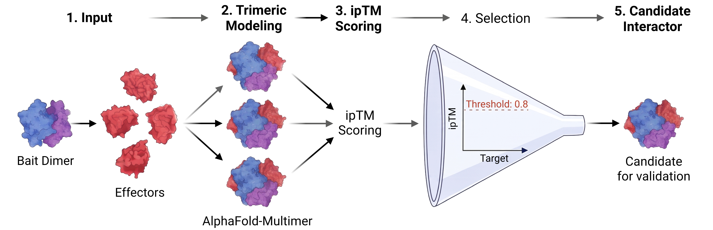

# Protein-protein interaction: 14-3-3 zeta vs Legionella effectors

Computational screen of interactions between human 14-3-3 zeta (1433Z) dimer and *Legionella pneumophila* effectors, using [ColabFold](https://github.com/sokrypton/ColabFold) (MSA with `colabfold_search`, AlphaFold-Multimer models with `colabfold_batch`).



> **Status:** complete (v1.0)  
> **Input from:** UniProt / pathogen3d (effector IDs)  
> **Output to:** ipTM scores (raw)

---

## Contents

- [ ] 1. [Installation](#1-installation)
- [ ] 2. [Inputs](#2-inputs)
- [ ] 3. [Running the screen](#3-running-the-screen)
- [ ] 4. [Getting the data and QC](#4-getting-the-data-and-qc)
- [ ] 5. [Analysis](#5-analysis)
- [ ] 6. [Plotting](#6-plotting)
- [ ] 7. [Troubleshooting](#7-troubleshooting)

---

## 1. Installation

### ColabFold

```bash
# TODO: install instructions / location on BIOMIX
```

### Python dependencies

```bash
# TODO
```

| Tool                | Version | Notes |
|---------------------|---------|-------|
| ColabFold           | TODO    | `colabfold_search`, `colabfold_batch` |
| Python              | TODO    | |
| SLURM (BIOMIX)      | TODO    | |

### Where it was run

| Step                          | Machine |
|-------------------------------|---------|
| Sequences + pairing           | local machine |
| MSA + multimer models         | BIOMIX (HPC cluster, SLURM) |

---

## 2. Inputs

| Input                    | Source                  | Description |
|--------------------------|-------------------------|-------------|
| Bait                     | UniProt                 | human 14-3-3-zeta (1433Z_HUMAN), run as a dimer (2 copies) |
| Prey: 368 effectors      | pathogen3d db (UniProt IDs) | *L. pneumophila* effector IDs, from the pdf of all 368 IDs |

> TODO: note file names (`legionella_effectors_368.csv`, `1433Z_HUMAN.fasta`).

---

## 3. Running the screen

**Overview**
- Get **amino acid sequences** in fasta format
    - 14-3-3-zeta from human from UniProt
    - 368 *Legionella pneumophila* effector IDs (UniProt) from pathogen3d db
        - Download the pdf containing all 368 effector IDs
        - Convert pdf into csv with AI tools
            - Check random IDs to verify
        - Get fasta sequences for all IDs with `fetch_fasta_csv.py`
            - Fasta for each protein and a multifasta is made
- Make bait:protein **paired-fasta**
    - Make a bait:bait:prey pair up with `pair_bait_protein.py`
- **MSA** with `colabfold_search` on BIOMIX
    - Make job script to run MSA (`run_msa_cf_search.sh`)
        - Use fewer threads to avoid needing more memory/diskspace to r/w
    - Reserve hardware and time, and submit the job `submit_biomix_cf_search_msa_no_cpu.slurm`
    - QC MSA (.a3m) files + check MSA depth of bait and prey proteins
- Generate AlphaFold **multimer models** with `colabfold_batch`
    - Make job script to feed the MSA files to af_multimer `run_multimer_cf_batch.sh`
    - Submit job to the HPC cluster with `submit_biomix_cf_batch_multimer.slurm`
    - QC PDB files (check log, match .pdb generated, atoms, plDDT and pTM, and validity of pdbs)
    - Get raw ipTM scores with `get_ipTM.py`

### 3.1 Get amino acid sequences (local machine)

```bash
python3 fetch_fasta_csv.py -i legionella_effectors_368.csv
```

### 3.2 Make bait:protein pairs (local machine)

```bash
python3 pair_bait_protein.py -i ./proteins/multi_fasta.fasta -bf 1433Z_HUMAN.fasta --bait-copy 2
```

### 3.3 MSA (BIOMIX / HPC cluster)

```bash
# submit job on BIOMIX/HPC cluster
sbatch submit_biomix_cf_search_msa_no_cpu.slurm

# check run status
squeue -u $USER
tail -f colabfold_search_biomix.log
```

| Script | Purpose |
|--------|---------|
| `run_msa_cf_search.sh` | job script for `colabfold_search` (fewer threads to limit memory/disk r/w) |
| `submit_biomix_cf_search_msa_no_cpu.slurm` | reserves hardware and time |

### 3.4 Multimer models (BIOMIX / HPC cluster)

```bash
# submit job on BIOMIX/HPC
sbatch submit_biomix_cf_batch_multimer.slurm

# job status check, same as before+
tail -n 20 output_predictions/log.txt
```

| Script | Purpose |
|--------|---------|
| `run_multimer_cf_batch.sh` | feeds the MSA files to af_multimer (`colabfold_batch`) |
| `submit_biomix_cf_batch_multimer.slurm` | reserves hardware and time |

> TODO: record the exact parameters used for the final run.

---

## 4. Getting the data and QC

### 4.1 QC of .a3m

```bash
# check output file (.a3m) integrity
for f in *.a3m; do
  # Check if empty
  if [ ! -s "$f" ]; then
      echo "EMPTY: $f"
      continue
  fi

  # Check if a sequence header exists anywhere in the file
  if ! grep -q "^>" "$f"; then
      echo "INVALID FORMAT (No '>' headers): $f"
      continue
  fi

  # Count MSA depth (number of sequences)
  seq_count=$(grep -c "^>" "$f")
  if [ "$seq_count" -lt 2 ]; then
      echo "LOW DEPTH ($seq_count sequences): $f"
  fi
done

# check MSA depth for bait and prey
echo "filename,file_size_bytes,sequence_count_bait,sequence_count_protein" > msa_summary.csv

for f in *.a3m; do
  awk -v f="$f" -v size="$(stat -c%s "$f")" '
    function tally(   a, b) {
      gsub(/[a-z]/, "", seq)            # drop lowercase insertions
      a = substr(seq, 1, L); b = substr(seq, L + 1)
      gsub(/-/, "", a); gsub(/-/, "", b)
      nb += (a != "" && b == "")        # residues only in bait part
      np += (a == "" && b != "")        # residues only in protein part
    }
    NR == 1 { split($0, h, /[#,\t]/); L = h[2]; next }   # bait length from header
    /^>/    { tally(); seq = ""; next }
    { seq = seq $0 }
    END { tally(); printf "%s,%s,%d,%d\n", f, size, nb, np }
  ' "$f" >> msa_summary.csv
done

cat msa_summary.csv
```

### 4.2 QC of .pdb

Run from inside the pdb-containing directory, at the CLI.

```bash
# number of pdbs generated
ls *.pdb | wc -l

# check atom numbers
for f in *.pdb;
do echo -n "$f: ";
  grep -c "^ATOM" "$f" | tr '\n' ' ';
  echo -n "atoms | Last line: "; tail -n 1 "$f";
done
echo
```

**plDDT scores**

```bash
python3 -c '
import glob
import os

output_file = "plddt_summary.txt"
lines = []

for pdb_file in sorted(glob.glob("*.pdb")):
    scores = []
    with open(pdb_file, "r") as f:
        for line in f:
            if line.startswith("ATOM") and line[12:16].strip() == "CA":
                try:
                    scores.append(float(line[60:66].strip()))
                except ValueError:
                    continue

    if scores:
        avg_plddt = sum(scores) / len(scores)
        result = f"{os.path.basename(pdb_file):35s} | Residues: {len(scores):4d} | Avg pLDDT: {avg_plddt:.2f}"
    else:
        result = f"{os.path.basename(pdb_file):35s} | CORRUPTED / NO ATOMS FOUND"

    lines.append(result)
    print(result)

if lines:
    with open(output_file, "w") as out_f:
        out_f.write("\n".join(lines) + "\n")
    print(f"Done. Processed {len(lines)} files. Summary saved to {output_file}\n")
'
```

**pTM scores**

```bash
python3 -c '
import glob, json, os

output_file = "ptm_summary.txt"
lines = []

for json_file in sorted(glob.glob("*scores*.json") or glob.glob("*.json")):
    ptm_val = "N/A"
    try:
        with open(json_file, "r") as jf:
            data = json.load(jf)
            key = "ptm"
            if key in data:
                ptm_val = f"{float(data[key]):.3f}"
    except Exception:
        pass

    result = f"{os.path.basename(json_file):45s} | pTM: {ptm_val:>5s}"
    lines.append(result)
    print(result)

if lines:
    with open(output_file, "w") as out_f:
        out_f.write("\n".join(lines) + "\n")
    print(f"\nSaved pTM summary for {len(lines)} JSON files to {output_file}")
'
```

**File validity**

```bash
python3 -c '
import glob, os

corrupted = []
valid_count = 0

for pdb in sorted(glob.glob("*.pdb")):
    filename = os.path.basename(pdb)

    # Check 1: File size
    bytes_size = os.path.getsize(pdb)
    if bytes_size >= 1024 * 1024:
        size_str = f"{bytes_size / (1024*1024):.2f} MB"
    else:
        size_str = f"{bytes_size / 1024:.1f} KB"

    chk_size = f"PASS ({size_str})" if bytes_size > 0 else "FAIL (0 B)"

    if bytes_size == 0:
        chk_atoms = "FAIL (Empty)"
        chk_end = "FAIL (Empty)"
        corrupted.append(filename)
        print(f"{filename:45s} | Size: {chk_size:15s} | Atoms/Coords: {chk_atoms:15s} | END Record: {chk_end} | Status: FAILED")
        continue

    has_end = False
    ca_count = 0
    has_nan = False

    with open(pdb, "r") as f:
        for line in f:
            if "NaN" in line or "Inf" in line:
                has_nan = True
            if line.startswith("ATOM") and line[12:16].strip() == "CA":
                ca_count += 1
            if line.startswith("END"):
                has_end = True

    # Check 2: Atom content and numeric validity
    if ca_count > 0 and not has_nan:
        chk_atoms = f"PASS ({ca_count} CAs)"
    elif has_nan:
        chk_atoms = "FAIL (NaN/Inf)"
    else:
        chk_atoms = "FAIL (0 CAs)"

    # Check 3: END record
    chk_end = "PASS" if has_end else "WARN (Missing)"

    # Overall file status
    if ca_count == 0 or has_nan:
        status = "FAILED"
        corrupted.append(filename)
    elif not has_end:
        status = "WARNING"
    else:
        status = "VALID"
        valid_count += 1

    print(f"{filename:45s} | Size: {chk_size:15s} | Atoms/Coords: {chk_atoms:15s} | END Record: {chk_end:14s} | Status: {status}")

print(f"\nSanity Check Complete: {valid_count} Valid | {len(corrupted)} Corrupted")
'
```

---

## 5. Analysis

Get raw ipTM scores:

```bash
python3 get_ipTM.py -i output_predictions/
```

> TODO: describe output format, ipTM cutoffs used and why.

---

## 6. Plotting

```python
# TODO
```

Planned plots (TODO):
- [ ] ipTM distribution across the 368 effectors
- [ ] Top-ranked effectors by ipTM (bar)

---

## 7. Troubleshooting

| Problem | Fix |
|---------|-----|
| MSA job runs out of memory / disk | use fewer threads in `run_msa_cf_search.sh` |
| TODO    | TODO |

---

## Output files

| File | Description |
|------|-------------|
| `proteins/multi_fasta.fasta` | multifasta of all effectors |
| `*.a3m` | MSA files |
| `msa_summary.csv` | MSA size and depth (bait / protein) |
| `output_predictions/*.pdb` | multimer models |
| `plddt_summary.txt` | average pLDDT per model |
| `ptm_summary.txt` | pTM per model |
| ipTM scores | output of `get_ipTM.py` |

## References

- Mirdita M. et al. ColabFold: making protein folding accessible to all. *Nat Methods* 19, 679–682 (2022). https://doi.org/10.1038/s41592-022-01488-1
- ColabFold GitHub: https://github.com/sokrypton/ColabFold
